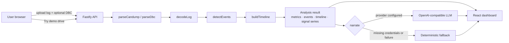

# CAN Log Narrator

CAN Log Narrator turns a candump-format CAN bus log and an optional DBC file into an evidence-backed timeline of vehicle activity. It decodes signals, detects noteworthy intervals with deterministic rules, correlates related detections into episodes, charts the decoded measurements, and produces a cautious plain-English narrative that cites the evidence behind every finding.

## Problem statement

CAN logs are easy to record and hard to explain. A raw candump file is a list of timestamps and hexadecimal payloads; understanding it requires the vehicle's DBC, signal scaling, domain knowledge, and manual cross-referencing. Generic LLM chat interfaces make the problem worse because they can invent measurements and causes.

This project separates the two jobs:

1. **Deterministic analysis** parses, decodes, detects, and correlates. It is reproducible and testable.
2. **Narration** explains the finished analysis. It may be an LLM or a deterministic fallback, but it never replaces the detector engine.

## Features

- **candump parsing** with standard/extended IDs, validation, warnings, and input limits
- **DBC decoding** for little-endian signals with scaling, offsets, signed values, units, and value tables
- **Six detectors**: rapid deceleration, brake activity, ABS activation, gear changes, telemetry dropout, and traffic bursts
- **Correlated timeline** that preserves every original event and evidence item
- **Interactive React dashboard** with metrics, event evidence, time-series charts, missing-data gaps, and range selection
- **Evidence panel** showing measured/derived values, detection rule, correlated detections, and limitations
- **AI narration** through any OpenAI-compatible endpoint, with a no-key deterministic fallback
- **Demo drive** that runs the bundled synthetic log through the real analysis pipeline
- **Fastify API** with multipart uploads, size limits, CORS, validated narration inputs, and in-memory analysis references

## Architecture



### Stack

- **Backend:** Node.js 20.19+ (or 22.12+), TypeScript, Fastify, Vitest
- **Frontend:** React 19, TypeScript, Vite, Recharts
- **Core:** pure TypeScript functions with no Node-only APIs

## Local setup

```bash
npm install
npm test
npm run typecheck
```

Run the application in development:

```bash
# terminal 1 — API on http://127.0.0.1:3001
npm start

# terminal 2 — Vite frontend on http://127.0.0.1:5173
npm run dev:web
```

Open `http://127.0.0.1:5173`. Vite proxies `/api` to the backend.

Production build and single-port serve:

```bash
npm run build
npm start
# dashboard and API both at http://127.0.0.1:3001
```

`npm run build` typechecks the backend and frontend, then writes the Vite build to `dist/web`. The Fastify server serves that directory when it exists.

## Demo workflow

Click **Try demo drive**. The frontend calls `GET /api/sample/analysis`, which runs the bundled `samples/drive_demo.log` and `samples/vehicle.dbc` through the same parser, decoder, detectors, and timeline code used for uploads. No demo values are hardcoded in the UI.

The demo log is **synthetic demonstration data**, generated by `scripts/generate-sample.ts` with a seeded PRNG (mulberry32, seed 42). It is not a recording from a real vehicle. It contains 4,440 frames over roughly 60 seconds and models a parked period, a park-to-drive shift, acceleration, cruise, a hard-braking window with ABS, a wheel-speed dropout, and a final cruise.

The "Try demo drive" flow works without an AI API key. The server returns deterministic fallback narration in that case.

## Supported input

### candump

```text
(1700000000.012345) can0 100#F401000000000000
(1700000000.020000) can0 18FEF100#1122334455667788
(1700000000.030000) can0 123#
```

- Timestamps are finite decimal seconds.
- Exactly 3 hex ID digits = standard 11-bit; exactly 8 = extended 29-bit.
- Payloads may be upper/lowercase or empty.
- CRLF, LF, and blank lines are handled.
- Remote frames (`#R...`), CAN FD (`##...`), malformed lines, invalid IDs, and payloads over 8 bytes are skipped with warnings, never by crashing the whole log.

### DBC

Supported: `BO_` messages, `SG_` signals, `VAL_` value tables, little-endian (`@1`) signed/unsigned signals, factor, offset, min/max, units, and message DLC 0–8.

Explicitly unsupported and rejected with a clear error:

- big-endian / Motorola signals (`@0`)
- multiplexed signals
- CAN FD DLC above 8

Definitions are validated for IDs, DLC, bit ranges, length, factor, numeric values, duplicate messages/signals, and ranges.

### Limits and data handling

- CAN log: 32 MiB
- DBC: 4 MiB
- JSON request body: 40 MiB
- Two uploaded files, 60-second request timeout
- Uploads are processed in memory and never stored on disk or executed.
- Analysis references are kept in memory for 10 minutes, capped at 50 entries.
- The API does not accept filesystem paths, so arbitrary server files cannot be read.

These limits and the supported subset mean the tool is **not compatible with every CAN log or every DBC file**.

## Detection approach

| Detector | What it looks for | Defaults |
| --- | --- | --- |
| `rapid_deceleration` | Sustained speed drop converted to m/s² | ≥10 km/h drop, ≥3 m/s², ≤5 s |
| `brake_activity` | Elevated brake pressure, or pedal/switch state | 50% / 5 bar / 500 kPa / 50 psi, ≥0.2 s |
| `abs_activation` | Transition into a configured ABS-active state | raw/decoded value 1 or active labels |
| `gear_change` | State change in a gear-named signal | one event per change |
| `signal_dropout` | Gap far beyond observed/configured message interval | 3× interval, minimum 0.5 s |
| `traffic_burst` | Windowed frame count above inferred baseline | 1 s window, 3× baseline, ≥10 frames |

Default signal aliases (for example `Speed_kmh`, `BrakePressure_pct`, `ABS_Active`, `GearPosition`) are heuristics, not universal standards. Every detector accepts explicit signal mappings and thresholds through the analysis configuration.

### Correlation and caution

Only braking detections (`rapid_deceleration`, `brake_activity`, `abs_activation`) are correlated into an episode, and only when they overlap or fall within the configurable `windowSec`. Gear changes, telemetry gaps, and traffic bursts remain independent entries; close timestamps alone never merge unrelated findings.

Timeline entries keep:

- `observedFacts` — measurements with timestamps and units
- `interpretations` — detector conclusions such as "Possible hard braking"
- `events` — the original detections with all of their evidence
- `limitations` — what the signals cannot establish

A rapid speed reduction is labeled **Rapid deceleration** unless brake evidence is present, in which case it becomes **Possible hard braking**. Correlation is treated as supporting evidence, not proof of driver intent, road conditions, or a fault.

## AI narration

`POST /api/narrate` accepts a validated analysis object or a stored `analysisId`. The prompt receives:

- log metadata and decoded signal definitions
- detected events with measured values, timestamps, and evidence
- the correlated timeline
- warnings, unsupported detectors, and limitations

The model is instructed to use only supplied evidence, preserve units and timestamps, separate facts from hypotheses, avoid root-cause and safety claims, and never invent events or measurements. Uploaded CAN data and decoded text are treated as untrusted; the model is told to ignore instructions embedded in them.

Responses are validated for structure, size, and timestamp range. On missing credentials, provider errors, malformed JSON, invalid shape, or invented timestamps, the API returns a deterministic report assembled from the timeline instead. The prompt contains derived analysis, not the raw uploaded file.

### Configuration

Copy `.env.example` to `.env`. `npm start` and `npm run dev` load it when present.

| Variable | Purpose | Default |
| --- | --- | --- |
| `PORT` | API port | `3001` |
| `HOST` | API bind address | `127.0.0.1` |
| `CORS_ORIGIN` | Comma-separated browser origins | `http://localhost:5173,http://127.0.0.1:5173` |
| `VITE_API_BASE_URL` | API base for a separately hosted frontend | empty (same origin/proxy) |
| `NARRATION_PROVIDER` | `none` or `openai-compatible` | `none` |
| `NARRATION_BASE_URL` | API base without `/chat/completions` | — |
| `NARRATION_API_KEY` | Bearer token; may be empty for local servers | — |
| `NARRATION_MODEL` | Provider model identifier | — |
| `NARRATION_TIMEOUT_MS` | LLM timeout | `60000` |

Local example with Ollama (no key):

```bash
NARRATION_PROVIDER=openai-compatible
NARRATION_BASE_URL=http://localhost:11434/v1
NARRATION_API_KEY=
NARRATION_MODEL=llama3.2
```

Never commit `.env` or API keys. `.gitignore` excludes them.

## API

| Method | Route | Purpose |
| --- | --- | --- |
| `GET` | `/api/health` | Status, narration configuration, limits |
| `GET` | `/api/sample` | Sample metadata; `?include=text` returns log/DBC text |
| `GET` | `/api/sample/analysis` | Real pipeline over the bundled sample |
| `POST` | `/api/analyze` | Multipart `log`, optional `dbc`, optional `config` |
| `POST` | `/api/narrate` | `{ analysis }` or `{ analysisId }` |

```bash
curl -s http://127.0.0.1:3001/api/sample/analysis

curl -s -X POST http://127.0.0.1:3001/api/analyze \
  -F "log=@samples/drive_demo.log" \
  -F "dbc=@samples/vehicle.dbc" \
  -F 'config={"detectors":{"traffic":{"windowSec":1}},"timeline":{"windowSec":2}}'
```

Analysis responses include parsing statistics, decoded signal metadata, chartable series, unknown-ID statistics, detected events, the correlated timeline, warnings, and unsupported detectors.

Errors use one shape:

```json
{ "error": { "code": "invalid_dbc", "message": "...", "details": ["..."] } }
```

There is deliberately no authentication for the local demo. Do not expose an unauthenticated deployment to untrusted networks without adding access control.

## Frontend

The dashboard is an engineering workspace rather than a chat interface:

- **Overview metrics** for total/decoded frames, unknown IDs, duration, events, and warnings
- **Timeline** with severity, timestamps, confidence, correlated detections, and evidence selection
- **Signal explorer** with unit-aware Recharts line/step charts, tooltips, time-range sliders, event focus, and visible gaps instead of interpolated values
- **Evidence panel** with measured/derived values, the exact detection rule, correlated events, and limitations
- **Narrative panel** separating deterministic observed facts, generated interpretation, important findings, caveats, and unanswerable questions
- **States** for loading, empty analysis, API errors, narration failure, and deterministic fallback

Charts cap each signal at 5,000 points per response to keep the browser responsive; the UI labels truncated series. Raw samples are not resampled or smoothed.

## Example findings from the demo

Running the bundled sample produces:

- a park-to-drive gear change near 10.0 s
- a possible hard-braking episode from roughly 39.9 s to 43.0 s, with speed falling from about 50.9 km/h to 15 km/h (about 3.2 m/s²)
- brake pressure peaking at 90 % during that episode
- ABS reported active from about 41.0 s to 42.55 s
- a WheelSpeed telemetry gap of about 3.05 s from roughly 49.95 s to 53.0 s

These are demo values, not vehicle-specific claims.

## Testing

```bash
npm test              # Vitest suites
npm run typecheck     # backend + frontend
npm run build:web     # Vite production build
```

The suite covers parsing, DBC validation, signed/scaled decoding, payload-length handling, endianness rejection, timestamp irregularities, every detector, deceleration noise/boundaries/irregular sampling, timeline correlation/separation/deduplication/evidence preservation, API uploads/limits/errors, narration validation and fallback, and a jsdom frontend test that renders the real sample analysis and inspects ABS evidence. External model calls are never made in tests.

## Screenshots

Add screenshots after a local run (paths reserved; files are not committed yet):

- `docs/screenshots/landing.png` — upload screen and demo button
- `docs/screenshots/dashboard.png` — metrics, timeline, signal explorer
- `docs/screenshots/evidence.png` — selected event evidence and detection rule
- `docs/screenshots/narrative.png` — AI/fallback narrative with caveats

## Project layout

```text
src/core/                  pure parsing, decoding, detection, timeline
src/services/              analysis orchestration and narration provider
src/server/                Fastify routes, validation, static frontend serving
web/src/                   React dashboard, API client, components, styles
web/src/App.test.tsx       jsdom frontend workflow test
tests/                     backend and core Vitest suites
scripts/generate-sample.ts deterministic synthetic demo generator
samples/                   DBC and generated demo log
```

## Limitations

- Classic CAN only (0–8 byte payloads); no CAN FD, remote frames, J1939, or ISO-TP reassembly.
- Little-endian DBC signals only; big-endian and multiplexed signals are rejected rather than misdecoded.
- Signal aliases and thresholds are heuristics and may need configuration per vehicle.
- Dropout and traffic baselines are inferred from the log unless configured; event-driven messages can look like dropouts.
- Timeline correlation is temporal and thematic, not causal.
- The LLM narrative can still be wrong or overly confident; the deterministic analysis and fallback remain authoritative.
- No authentication, multi-user isolation, database, or persistent analysis storage in this MVP.
- Not tested against every candump variant or every DBC dialect.

## Safety and interpretation

This is an engineering analysis aid, not a certified diagnostic system. Decoded values depend on the DBC, signal scaling, sampling rate, and log integrity. A correlated braking episode supports a hypothesis; it does not establish driver intent, road conditions, or a fault. Treat every event and narrative as a lead to verify, not a conclusion.
